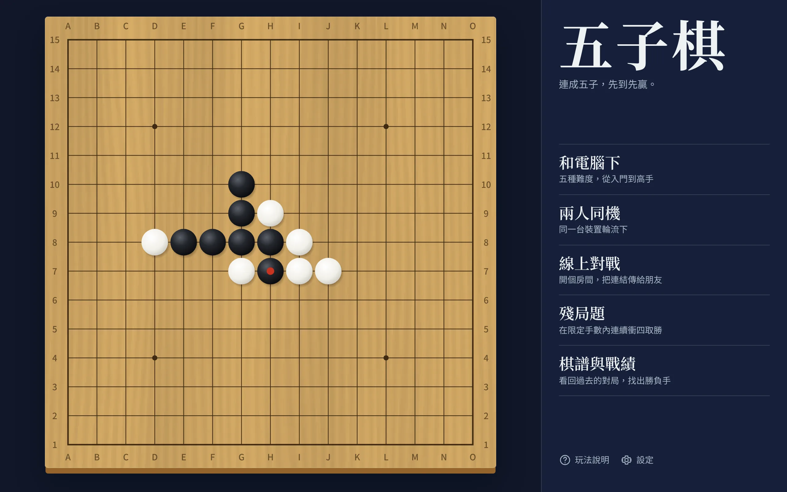
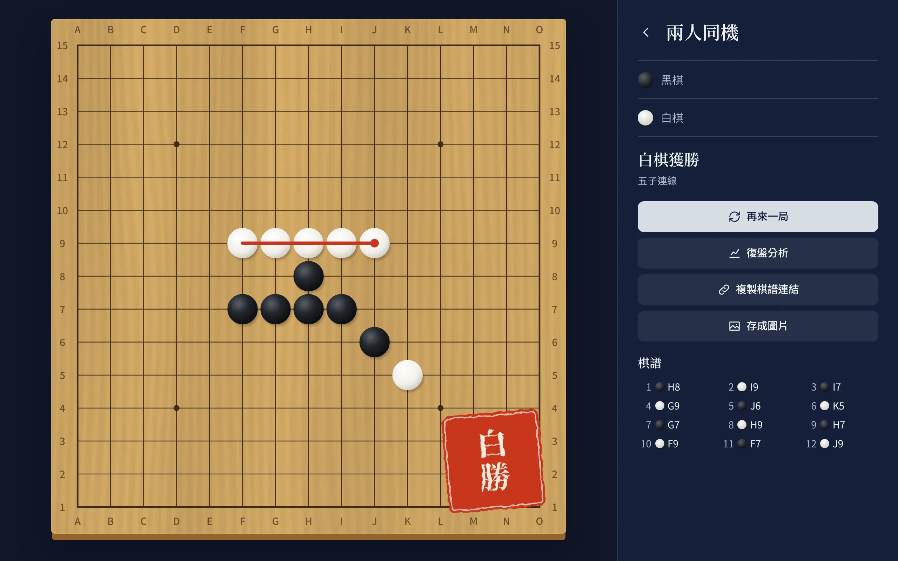
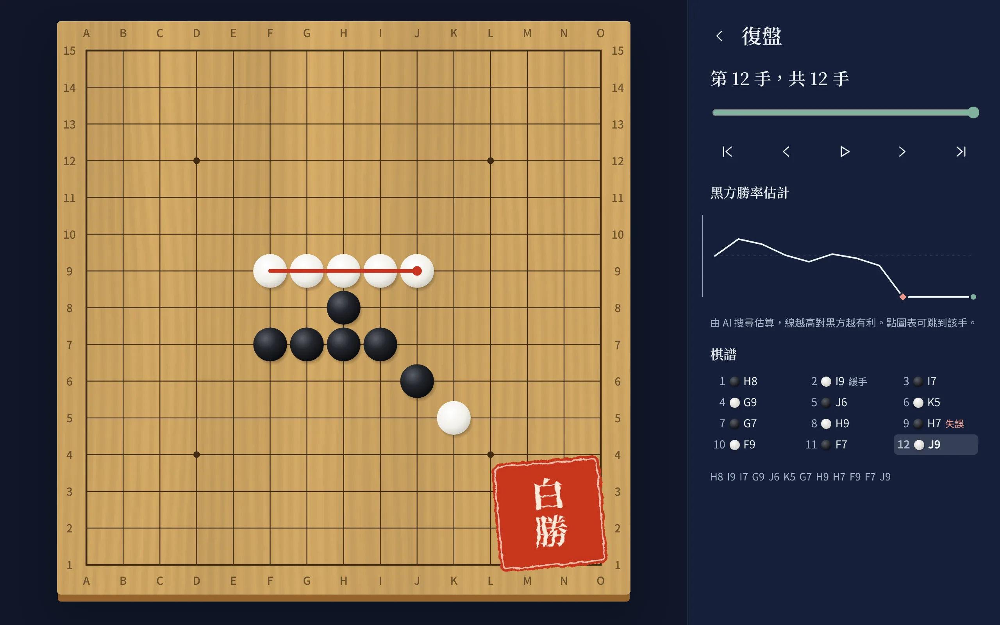
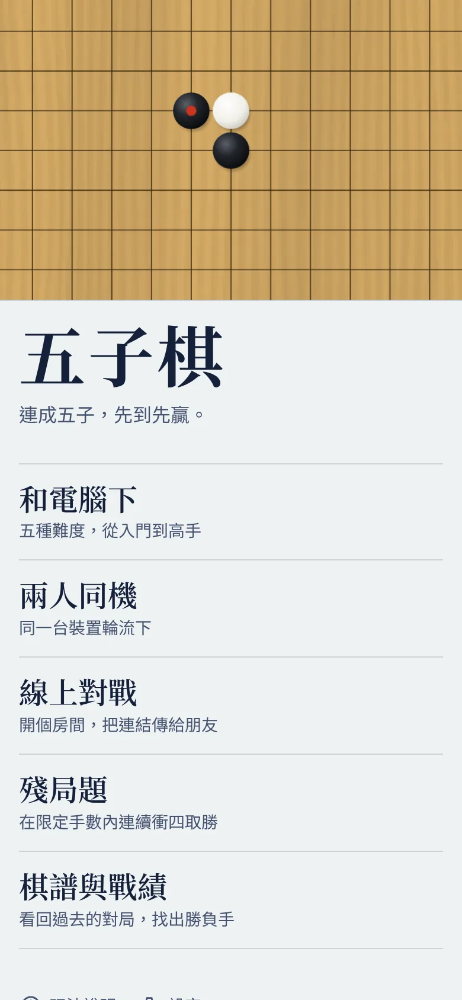

# 五子棋 Gomoku

[](https://github.com/ToruSmith/GomokuGamets/actions/workflows/ci.yml)

一款裝得進手機、斷網也能玩的五子棋。有認真的 AI、連珠禁手、賽後分析，也能開房間和朋友線上對戰。

**[立即開始下棋](https://gomokugamets.pages.dev/)**



| 分出勝負                                               | 賽後分析                                            | 手機版                                      |
| ------------------------------------------------------ | --------------------------------------------------- | ------------------------------------------- |
|  |  |  |

## 功能

**對局**

- 和電腦下：入門、初級、中級、高級、高手五段，可選黑白
- 兩人同機、線上對戰
- 自由、標準、連珠三種規則，連珠會在棋盤上標出黑棋禁手
- 13、15、19 路棋盤（連珠固定 15 路），每方可限時 5 或 10 分鐘
- 悔棋、提示，對局自動保存，關掉再開可以接著下

**線上對戰**

- 開房後傳一條連結給朋友就能開始
- 重新整理或斷線後回到同一盤棋
- 開房可選每方 5 或 10 分鐘，時間由伺服器時間戳計算
- 認輸、再戰（交換黑白）、傳送表情
- 第三個人打開連結會變成觀戰

**學習**

- 復盤：拖曳時間軸、自動播放、從任一手接著下
- 賽後分析：勝率曲線，標出緩手、失誤、錯過的勝機，並顯示 AI 建議
- 14 題殘局：用連續衝四在限定手數內取勝，每題都由測試驗證有解
- 棋譜連結、文字棋譜匯入、存成圖片
- 對局紀錄與各難度戰績

**體驗**

- PWA：可安裝到主畫面，第一次載入後可離線遊玩
- 榧木、檜木、墨色、青瓷四種棋盤，淺色與深色主題
- 繁體中文與英文
- 手機點兩下才落子，避免誤觸（可在設定關閉）
- 全鍵盤操作（方向鍵移動、Enter 落子、U 悔棋、H 提示），支援讀屏軟體與減少動態效果

## 快速開始

需要 Node.js 22 以上。

```bash
npm install
npm run dev        # http://localhost:5173
```

| 指令                 | 用途                               |
| -------------------- | ---------------------------------- |
| `npm run dev`        | 開發伺服器，存檔後重新整理即可看到 |
| `npm run build`      | 建置正式版到 `dist/`               |
| `npm run preview`    | 建置並在本機預覽正式版             |
| `npm run build:demo` | 打包成單一 HTML 檔（不含線上對戰） |
| `npm run check`      | 型別、格式、單元測試與建置一次跑完 |
| `npm test`           | 單元測試                           |
| `npm run test:e2e`   | 瀏覽器端對端測試                   |
| `npm run format`     | 自動排版                           |

第一次跑端對端測試前，請先執行 `npx playwright install chromium`。

## 部署

### Cloudflare Pages

1. 在 Cloudflare Pages 連接這個儲存庫，正式版分支選 `main`
2. 建置指令填 `npm run build`，輸出目錄填 `dist`
3. 推送到 `main` 會更新正式網址，其他分支會產生預覽網址

所有資源都用相對路徑，放在子路徑或自訂網域都能運作。

### Firebase（線上對戰）

不需要線上對戰的話可以略過，其他功能都不依賴 Firebase。

**沿用現有專案**：`src/online/firebase-config.ts` 已經填好 `gomokugamets-6c274`，只要部署新的安全規則：

```bash
npm install -g firebase-tools
firebase login
firebase deploy --only database
```

> [!IMPORTANT]
> 這一步一定要做。舊版規則讓任何登入者都能改別人的棋局，新版規則才有實際的保護。

**使用新專案**：

1. 在 [Firebase Console](https://console.firebase.google.com/) 建立專案
2. 建立 Realtime Database，區域選 `asia-southeast1`（離台灣最近）
3. 在 Authentication 啟用**匿名**登入
4. 在 Authentication → Settings → 已授權的網域，加入 `你的專案.pages.dev`
5. 把網頁應用程式的設定貼到 `src/online/firebase-config.ts`，並修改 `.firebaserc` 的專案 ID
6. 執行上面的部署指令

Firebase 網頁設定裡的 `apiKey` 本來就會出現在每個訪客的瀏覽器中，放進版本控制沒有問題。資料安全靠的是安全規則。

## 線上對戰怎麼防作弊

沒有自己的伺服器，所以設計時假設客戶端不可信：

- **勝負不存在資料庫**。雙方都從棋步重演出結果，沒有「贏家」欄位可以偽造
- **只能下自己的回合**。規則檢查寫入者是不是該手的棋手，棋步也寫入後不能改
- **只能替自己認輸**
- **不合法的資料判負**。重複落子、跳手、下在禁手點，一律判該方輸
- **過期房間自動清理**。開新房時會順手清掉超過 24 小時的舊房間

## AI 怎麼運作

盤面評估用五元組：棋盤上每個連續 5 格的窗格都記錄黑白子數，落子時只更新經過該點的窗格。搜尋是迭代加深的 alpha-beta，搭配置換表、殺手著與歷史啟發。對手有四時只能擋，這類節點不消耗深度，所以連續衝四看得很遠；高級以上還會專門搜尋連續衝四必勝，並檢查自己這手會不會讓對手有必勝手順。

所有計算都在 Web Worker 內執行，畫面不會卡住。

和舊版最強的「困難」實際對戰的結果（各 16 局，雙方輪流執黑，開局兩手固定 8 種變化）：

| 新版難度 | 勝  | 負  |
| -------- | --- | --- |
| 初級     | 10  | 6   |
| 中級     | 15  | 1   |
| 高級     | 16  | 0   |

高手的思考時間最長，沒有列入這項對戰。

## 專案結構

```
src/
├── core/      規則、棋局、棋譜編碼（純邏輯，無 DOM）
├── ai/        搜尋引擎、難度、賽後分析、Worker
├── online/    房間流程與 Firebase 後端
├── state/     響應式核心、設定、戰績、各種對局模式
├── platform/  儲存與音效
├── i18n/      翻譯
├── ui/        棋盤、圖表與各頁面
└── styles/
tests/         單元測試（Node 內建測試器）
e2e/           瀏覽器測試（Playwright）
scripts/       建置與產生素材的腳本
docs/          架構說明與截圖
```

執行期沒有任何 npm 相依，Firebase SDK 只在進入線上對戰時才從 CDN 載入。想改東西之前，建議先看 [架構說明](docs/architecture.md)。

## 測試

- `tests/rules.test.ts`：勝負判定與連珠禁手
- `tests/engine.test.ts`：AI 戰術、三種規則下的自我對弈、賽後分析
- `tests/online.test.ts`：完整線上流程與十多種作弊嘗試，每次寫入都會經過 `database.rules.json`
- `tests/puzzles.test.ts`：每題殘局都有解，且沒有更短的解
- `e2e/`：真實瀏覽器裡的點擊精度、手機觸控、雙分頁線上對戰、復盤、設定保存

## 常見問題

**線上對戰顯示連不上伺服器？**
確認匿名登入已啟用、網站網域已加入已授權的網域，並且部署過安全規則。

**為什麼部署後看到的還是舊版？**
PWA 會先用快取，新版在下一次開啟時生效。關掉分頁再開一次就好。

**舊版的戰績會保留嗎？**
舊版的戰績本來就沒有存檔，重新整理就會歸零，所以沒有資料要轉移。

更新內容請見 [CHANGELOG](CHANGELOG.md)。
